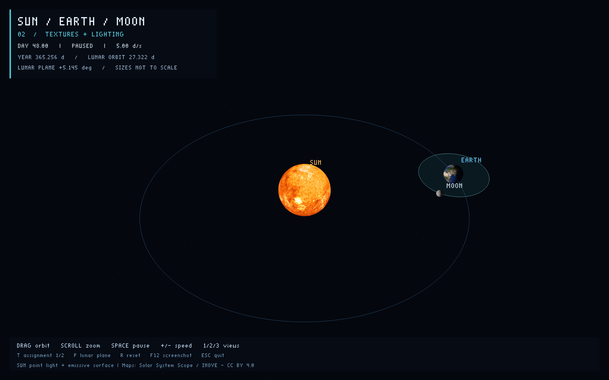
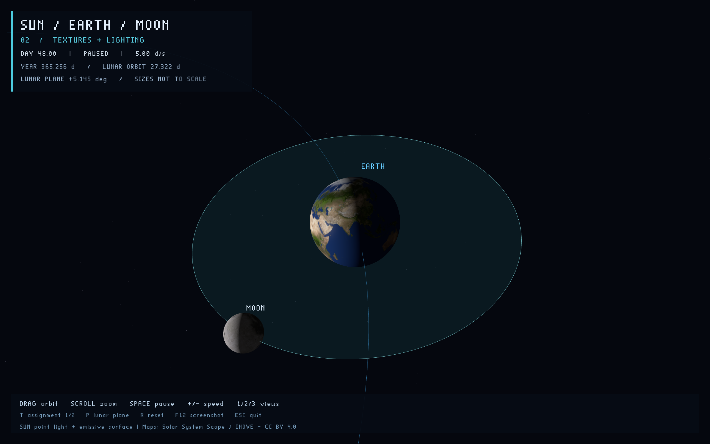

# Sun / Earth / Moon

使用 **C++17 + OpenGL 3.3 Core** 实现的日地月运动模型，计算机图形学课程作业。

- **作业一**：圆形公转轨道、自转、月球轨道倾角和交互观察，使用无光照经向色带。
- **作业二（默认）**：地球、月球、太阳纹理，太阳位置点光源，Blinn–Phong 光照和太阳自发光。
- 按 **T** 在两份作业间切换，时间、相机和运动模型保持不变。





### 作业一对照


## 构建与运行

需要 CMake 3.24+、Git、C++17 编译器和支持 OpenGL 3.3 的显卡驱动。
首次配置会下载固定版本的 GLFW 和 GLM，需要网络；运行程序不需要网络。

### macOS

使用 Xcode 或 Command Line Tools 提供的 Clang 和 SDK：

```sh
cmake -S . -B build -DCMAKE_BUILD_TYPE=Release
cmake --build build -j 8
ctest --test-dir build --output-on-failure
open build/sun-earth-moon.app
```

如果完整 Xcode 尚未配置，但已安装独立 Command Line Tools，可以只为本次命令指定工具链，不修改全局设置：

```sh
export DEVELOPER_DIR=/Library/Developer/CommandLineTools
cmake -S . -B build -DCMAKE_BUILD_TYPE=Release
cmake --build build -j 8
```

### Windows

安装 Visual Studio 2022 的“使用 C++ 的桌面开发”工作负载，以及 CMake、Git：

```powershell
cmake -S . -B build -A x64
cmake --build build --config Release
ctest --test-dir build -C Release --output-on-failure
.\build\Release\sun-earth-moon.exe
```

Windows 构建配置使用静态 GLFW 和 MSVC 运行库，不依赖单独安装 GLFW DLL。
仍需要显卡厂商的 OpenGL 3.3+ 驱动，不能将系统显卡驱动打进应用。
**Windows 尚未实机验证，不能把跨平台源码视为已经验证的 Windows 成品。**

### Linux（可选）

安装 C++ 编译器、CMake、Git 以及 GLFW 所需的系统开发包。例如 Ubuntu 的 X11 路径需要 `xorg-dev`：

```sh
cmake -S . -B build -DCMAKE_BUILD_TYPE=Release -DGLFW_BUILD_WAYLAND=OFF
cmake --build build -j 8
ctest --test-dir build --output-on-failure
./build/sun-earth-moon
```

Linux 尚未实机验证。

## 操作

| 操作 | 功能 |
| --- | --- |
| 鼠标左键拖动 / 滚轮 | 环绕观察 / 缩放 |
| Space | 暂停、继续 |
| `+` / `-` | 加速、减速（模拟天 / 真实秒） |
| `1` / `2` / `3` | 全景 / 跟随地球 / 俯视 |
| `T` | 切换作业一 / 作业二，不重置时间和视角 |
| `P` | 显示、隐藏月球轨道平面 |
| `R` | 重置时间、速度和视角（保留暂停状态及作业模式） |
| F12 | 向当前工作目录写入 `screenshot.png`，覆盖同名文件 |
| Esc | 退出 |

全景适合展示地球公转；跟随地球适合观察月球绕地、倾斜轨道以及自转。
macOS 的 F12 可能被系统快捷键占用，可使用下述截图参数。

## 运动模型与教学比例

采用右手坐标系，Y 轴向上，地球公转轨道位于 XZ 平面。
月球局部轨道绕 X 轴倾斜 **5.145°**，且轨道中心随地球移动，而不是绕世界原点运动：

```text
Earth(t) = (R cos(theta_e), 0, -R sin(theta_e))
Moon(t)  = Earth(t) + RotateX(5.145°) * (r cos(theta_m), 0, -r sin(theta_m))
theta    = 2*pi*t / period
```

- 地球公转周期：365.256 模拟天；月球绕地周期：27.322 模拟天。
- 地球自转周期：0.99727 模拟天，自转轴倾角：23.44°，轴方向在世界空间中固定。
- 月球同步自转：其局部 -X 方向始终朝向地球。
- 太阳示意自转周期：25.4 模拟天；不模拟差异自转。
- 时间由真实帧间隔推进，暂停或改变速度不会改变相对周期。单帧间隔最多计入 0.1 秒，避免窗口阻塞后的巨大跳变。
- 默认 5 模拟天/秒：一年约 73 秒；观看地球自转时建议减速。

**这是圆轨道运动学教学模型，不是引力数值模拟。** 不模拟偏心率、轨道进动或地月质心修正。
球体半径为太阳 1.65、地球 0.63、月球 0.23；轨道半径为地球 10、月球 2.25。
尺寸和距离分别压缩以便观察，不代表真实比例，周期和倾角保留上述近似值。

## 作业二：纹理与光照原理

球体每个顶点包含位置、颜色、法线及 UV。UV 为经纬展开坐标；经度接缝两侧分别保留 U=0 和 U=1，避免三角形在接缝处横穿整张地图。V=0 对应北极和 JPEG 的首行，不翻转图片。
纹理使用经度重复、纬度边缘钳制和三线性 mipmap 过滤。

光照全部在**世界坐标系**计算：

```text
P = model * position
N = normalize(transpose(inverse(mat3(model))) * normal)
L = normalize(SunPosition - P)   # SunPosition = (0, 0, 0)
V = normalize(CameraPosition - P)
H = normalize(L + V)
diffuse = max(dot(N, L), 0)
specular = strength * max(dot(N, H), 0)^48  # 仅受光面计算
linearColor = albedo * (0.018 + 0.95 * diffuse) + specular
```

- 光源位于太阳中心，不跟随相机；地球高光系数 0.08，月球为 0.008。
- 0.018 的微弱环境光用于辨认夜侧轮廓，不是地球城市夜景贴图。
- 纹理以 `GL_SRGB8` 上传，采样时转为线性颜色，完成光照后在片元着色器编码回 sRGB；不再开启帧缓冲 sRGB 转换，避免重复校正。
- 太阳使用独立的自发光分支，不计算自身漫反射，不需要额外辅助灯。这是表面显示，不包含光晕或泛光后处理。
- 为适应压缩过的教学距离，没有按距离平方衰减；不是辐射度学模拟。
- 没有天体间投射阴影：昼夜分界来自球面法线，**不代表已实现日食、月食**。也未添加云层、大气散射或地形凹凸。
- 初始经度和轨道相位是演示约定，不对应真实日期的星历。

三张 2K 纹理来自 Solar System Scope / INOVE，采用 **CC BY 4.0**，原始 JPEG 未修改。
来源和再分发说明见 [贴图署名](assets/textures/ATTRIBUTION.md)；可执行包中位于 `licenses/TEXTURES.md`。
CMake 将压缩的 JPEG 编译进可执行文件，运行时无需寻找图片目录或联网。

## 截图与打包

命令行可固定时间、视角并在指定帧数后退出。截图由实际 OpenGL 帧缓冲输出，而非示意图：

```sh
# macOS；Windows / Linux 将程序路径替换为对应可执行文件
build/sun-earth-moon.app/Contents/MacOS/sun-earth-moon \
  --days 48 --view 1 --assignment 2 --frames 3 --screenshot docs/screenshots/textured-overview.png
build/sun-earth-moon.app/Contents/MacOS/sun-earth-moon \
  --days 48 --view 2 --assignment 2 --frames 3 --screenshot docs/screenshots/textured-earth-moon.png

# 构建完成后打包，产物在 build/ 下
(cd build && cpack -C Release)
```

`--assignment 1` 可直接启动作业一，省略则为作业二。`--days` 固定模拟时间；省略时正常播放。`--screenshot` 未指定帧数时默认运行 3 帧后退出。
macOS 包为 `.app`，Windows 包为 `.exe`；压缩包同时包含说明和依赖许可。
macOS 当前构建只面向本机架构，不是 Universal Binary；未做 Apple Developer ID 签名或公证，其他 Mac 的 Gatekeeper 可能要求用户确认。

## 源码导览

- `src/orbits.hpp`：轨道、自转与姿态计算，不依赖窗口和 GPU。
- `src/sphere.hpp`：球网格、法线、UV 及接缝处理。
- `src/renderer.cpp`：纹理加载、世界空间光照、轨道、星空、文字及 PNG 截图；使用 VAO/VBO 和 GLSL 330 着色器。
- `cmake/EmbedTextures.cmake`：把源图片转换为构建目录中的 C++ 字节数组，不提交生成文件。
- `src/main.cpp`：窗口、时间推进、相机、输入和界面。
- `tests/orbit_tests.cpp`：轨道半径、层级关系、非共面、周期、同步自转和地轴倾角检查。

- `tests/sphere_tests.cpp`：单位法线、UV 朝向、三角形绕序与接缝连续性检查。

## 版本保留

`homework-1` 标签保留最初的作业一实现（`7c7828e`）；当前版本同时支持两种模式。
历史作业一截图保留在 `overview.png` / `earth-moon.png`，作业二使用 `textured-` 前缀。
macOS 已进行实际 OpenGL 渲染和截图检查；Windows / Linux 的验证状态见上文。

## 许可

原创代码采用 [MIT License](LICENSE)。依赖及资源保留各自许可，详见 [THIRD_PARTY.md](THIRD_PARTY.md)。
